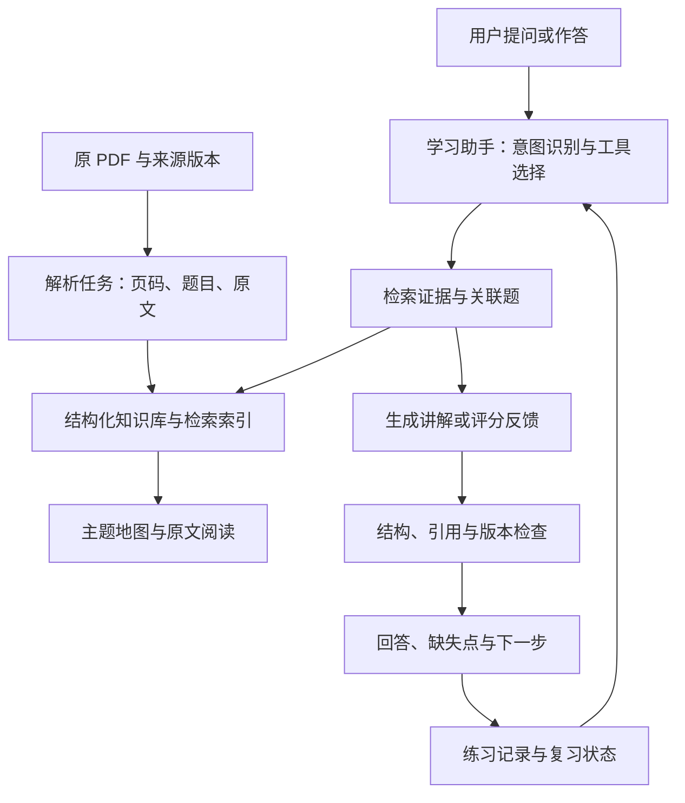

# Java + AI Agent 个人学习助手：开发方案

日期：2026-11-09。按个人使用、以 Java 后端为主并兼顾 AI 应用岗位设计；学习基础、考试时间与预算尚未指定，下面的学习顺序与工期属于可调整建议。

## 1. 推荐做成什么

做一个围绕自己资料的学习助手，核心流程是：**看知识地图 → 学一个主题 → 不看答案作答 → 找到遗漏 → 回看证据 → 再次复习**。

当前已经完成资料整理与本地阅读入口；接下来开发的重点是检索讲解、练习反馈和复习状态。这份方案没有表示 Agent 已实现或模型已接通。

第一版的完成标准：输入“我总混淆 volatile 和 synchronized”，系统能定位相关题目和页码，给出有依据的比较，出一道题等待你回答，再根据缺失点生成后续复习任务。

## 2. 对这份资料的具体判断

|检查项|结果|对开发的影响|
|---|---|---|
|总页数|301 页|可以本地解析与缓存|
|目录|第 1–42 页|检索时排除目录，避免每题重复召回|
|正文|第 43–301 页|页码始终保留 PDF 物理页码|
|题目|连续编号 1–800；800 个起始页全部与目录匹配|题目是可靠的第一层切分单位|
|原始组织|13 个模块|保留原章节，另建学习主题|
|本次分类|7 条主线、82 个主题；800 题各归一个主主题|可直接作为 Agent 的初始分类数据|
|交叉重复|已建立 12 个相关题簇|统一学习主题，但保留各题原始回答|
|技术准确性|未完成全量核验，已核验 Q043 的版本问题|原答案不能自动升级为标准答案|

例如：Q058 与 Q143 都讨论 sleep/wait；Q072 与 Q165–Q168 围绕 volatile；Q441–Q446 与 Q658–Q660 讨论分布式锁；RAG 分散在 Java AI Agent 和 AI 方向两章。

按这些关联整理，能避免把相似内容反复背成不同的知识点。当前“核心 / 进阶 / 选读”为学习建议，不是这 800 道题在招聘中的频率数据。

## 3. 第一版功能范围

|功能|学习时的表现|实现要点|
|---|---|---|
|知识地图|按主题看题量、先修知识与原题|使用本次 taxonomy；主题树与依赖边分开存|
|资料问答|回答带 Q 编号与 PDF 页码|先检索证据，后生成；缺证据时说明不足|
|知识卡片|30 秒口述版、关键原理、边界、易错点、相关题|结构化生成，逐字段保存依据与状态|
|主题小测|选一个主题，每次问一题|先提交回答，再展示参考要点|
|答题反馈|指出回答中哪些已覆盖、遗漏、错误或有争议|使用经过检查的评分要点；允许用户纠正评分|
|复习清单|优先复习薄弱和到期的主题|依据作答记录安排，记录时间预算|
|校订记录|并列展示原文、校订与官方出处|不覆盖原文；区分适用版本|

文字输入足以验证学习流程。语音面试、联网自动扩充、多用户、复杂权限、多 Agent 编排可以后续再加。

## 4. 技术选型

### 默认实现路线：先做个人工具

|层|第一版选择|理由|
|---|---|---|
|资料解析|Python + pypdf/pdfplumber；已解析的本文件直接复用 JSONL|本次无需重复 OCR 或重复上传|
|Agent 运行时|TypeScript + eve；按当前文档使用 Node.js 24+|把检索、取题、记录练习做成独立工具，方便评估|
|界面|先复用本地阅读页；接入 Agent 时补对话与练习界面|先验证学习流程，再扩展示图|
|业务数据|SQLite|个人题库、尝试记录、复习状态易备份|
|第一版检索|精确题号 + 别名词表 + 内存 BM25|800 道题可先走轻量方案，不依赖额外向量服务|
|模型连接|通过模型适配层配置；默认沿用 eve 的 AI Gateway 模型标识|模型选择与密钥分离，后续可替换供应方|
|后续语义检索|PostgreSQL + pgvector|需要语义召回时再增加，与业务表关联方便|

eve 的基础接入、工具目录和效果评估方式分别参考：[Getting Started](https://eve.dev/docs/getting-started)、[Tools](https://eve.dev/docs/tools)、[Evals](https://eve.dev/docs/evals)。这里选择它来组织一个主学习助手和有限工具，不要求多个 Agent。实施时固定依赖版本，并以安装包内对应文档为准。

### 如果还想把它做成 Java 求职项目

可把 Agent/业务后端换成 **Spring Boot + Spring AI**，复用同一份题库、评分标准和评测样例。这个方向更利于讲清 Java 框架、工具调用和 RAG；以对应版本的 [Spring AI 官方文档](https://docs.spring.io/spring-ai/reference/) 为实现依据。

两条路线择一开发。若主要目标是尽快用来学习，先完成默认路线；若主要目标是沉淀 Java 项目经历，优先选择自己熟悉的 Java 技术栈。不要为了同时展示框架而开发两套服务。

## 5. 系统结构



解析、编号校验、引用检查、复习日期计算是普通程序。Agent 主要负责理解学习意图、选择工具、组织讲解和追问。对明确的“查 Q800”“按主题列题”直接调用确定性查询即可。

会话上下文服务当前对话，题库提供外部知识，数据库保存学习事实。这三类信息分别管理；聊天记录不能替代学习进度表。

## 6. 文档入库与分类流程

1. **建立来源版本。** 保存文件 SHA-256、页数、解析器版本和导入时间。相同文件重复导入时复用已有结果。
2. **提取页面。** 保留每页原始文本及 page_number。扫描件或乱码页才进入 OCR 分支。
3. **识别目录与正文。** 本文件固定为目录 1–42、正文 43–301；新文件需检测后确认，不硬编码成通用规则。
4. **识别题目边界。** 结合编号、目录标题和正文定位；检测跨页题目。当前 800 题的完整标题都能与正文前缀匹配。
5. **保留原文与来源。** 当前题库含 page_start/page_end；将来若需要精确到句子的引用，增加页面跨度、字符位置，复杂版面再增加 bbox。
6. **按主题归类。** 主分类沿用 taxonomy；模型只提出新增/调整建议，返回结构化结果，并做编号覆盖与重复分配检查。
7. **建立关联。** 同义题、相近题、前置知识分别保存关系类型。相似度只能用于提出合并候选，不直接删除原题。
8. **生成知识卡片。** 以题目与主题为单位分批生成，再做模块摘要和全局导图；摘要必须能回溯到原题。
9. **标记准确性。** 区分未核验、已核验、有争议和待补充。新增内容带 source_kind 与依据。
10. **缓存并增量更新。** 按原文哈希、提示词版本和模型版本缓存卡片；修改一题只更新相关索引与摘要。

切分优先级是“题目与回答整体 → 回答内部的自然段 → 过长段落的 token 分块”。子块必须带题号、完整标题、主题路径和页码。可从每子块 400–800 tokens 的实验区间开始，用评测调整，不把参数当成通用标准。

同一页可能同时出现多道题，一道题也可能跨页，因此不要简单按页切分，或把全文交给一次模型调用来做所有摘要。

## 7. 数据结构

### 当前可复用的数据

`题库.jsonl` 已有 800 条记录，主要包含：

```json
{
  "id": "Q165",
  "number": 165,
  "title": "volatile 关键字的作用是什么？它具备哪两大特性？",
  "group_id": "runtime",
  "topic_id": "jmm",
  "page_start": 91,
  "page_end": 92,
  "verification_status": "not_fact_checked",
  "answer_original": "原回答文本，实际数据见题库",
  "content_hash": "实际 SHA-256 值见题库"
}
```

上面省略了原回答与实际哈希值。当前导出还保留原章节、原文标题、相关题号、建议阅读顺序和版本核验标记。

### 建议数据库表

|表|关键字段|用途|
|---|---|---|
|documents|document_id、revision_id、sha256、source_path、page_count|来源与版本|
|questions|question_id、document_id、revision_id、number、title、answer_original、pages、content_hash|原题事实|
|topics|topic_id、parent_id、name、learning_priority|知识树|
|knowledge_links|from_id、to_id、relation、review_status|相近题、先修关系、交叉主题|
|cards|card_id、question_id、source_hash、prompt_version、model_id、payload、review_status|生成讲解与知识卡片|
|evidence|evidence_id、source_kind、question_id、revision_id、page_span、url、verified_at、version_scope|原文、校订与补充证据|
|attempts|attempt_id、user_id、question_id、user_answer、rubric_version、grade、missing_points、created_at|保留每次作答|
|review_state|user_id、topic_id、last_attempt_id、interval_days、due_at、status|当前复习安排|

多文档题号可能都叫 Q001。数据库用 document_id + revision_id + number 保证唯一性，界面再展示易读题号。新版本题目映射成功后才迁移学习状态，不能只靠编号认定内容相同。

知识卡片建议字段：`oral_answer`、`key_points`、`pitfalls`、`follow_up_questions`、`source_refs`、`version_scope`、`review_status`。原文摘要、教学补充、官方校订分别标记。

## 8. 检索与回答策略

### 第一版

- 输入为 Q 编号时直接取题。
- 其他输入先处理同义表达，如“线程池 / ThreadPoolExecutor”“检索增强 / RAG”。
- BM25 的分词策略同时保留英文标识符和中文二元字串；验证中文短语与 Java API 名的召回效果。
- 标题、主题和答案分字段加权，给完整题目返回优先级。
- 从候选题中选择相关证据，允许附带相关题簇，禁止把整个题库拼进每次提示词。

### 第二版：评测证明有缺口时加入向量

关键词召回与向量召回各取一组候选，例如起始各 20 个；去重后做 RRF 融合，必要时重排，再选 3–6 个证据单元进入生成。这些数量是实验起点。

800 题可以先用精确向量扫描。只有在数据规模与延迟实测需要时再考虑近似索引。pgvector 支持精确与近似向量搜索；索引能力与约束以 [pgvector 官方仓库](https://github.com/pgvector/pgvector) 为准。

关键词分词要与索引方式配套；中文不能假设使用 PostgreSQL 默认全文检索即可获得良好分词效果。PostgreSQL 的检索配置、解析器和词典见 [官方全文检索文档](https://www.postgresql.org/docs/current/textsearch.html)。

### 返回格式

1. 直接结论。
2. 三到五个关键点，每点带 `source_refs`。
3. 适用条件、版本或资料冲突。
4. 一道检查理解的追问，或一个建议回看的主题。

前端把结构化引用渲染为“Q165 · PDF p91”。后端核对题号存在、页码属于来源范围、被引文本确实包含在证据中。引用格式合法与答案受证据支持是两个检查项。

证据不足时返回“资料中没有找到足够依据”，并列出已查到的相关题。若开放补充模式，再显示“补充解释”，避免把模型常识伪装成原文。

## 9. Agent 工具与运行约束

|工具|输入|输出或副作用|
|---|---|---|
|search_material|query、topic_id、limit|相关题、证据段、页码和分数|
|get_question|question_id、revision_id|完整原题、答案、校订、相关题|
|get_topic_map|topic_id、depth|主题、题号、关联与先修关系|
|start_practice|topic_id、difficulty、count|练习会话及下一道题；不提前返回参考答案给用户|
|submit_answer|practice_id、question_id、answer、operation_id|作答记录、评分与缺失点|
|get_review_plan|time_budget_minutes、date|到期与薄弱主题、预计用时|

评分由 submit_answer 工具内部调用模型或规则完成，参考答案与评分要点在后端使用。Agent 只接收给用户的题目与反馈，界面必须在提交前隐藏答案。

服务端校验工具参数与题库范围。初始可设置每轮最多 6 次工具调用、45 秒总执行预算、相同失败工具最多重试 1 次，并按实测调整。终止时保留已得到的证据并明确说明失败步骤。

练习写入使用稳定 operation_id 和唯一约束，防止网络重试造成重复作答记录；不要只靠提示词要求“别重复保存”。

## 10. 反馈与复习如何落地

### 评分示例：volatile

评估回答是否覆盖可见性、必要的有序性语义，以及“不能让 i++ 自动成为原子操作”。评分标准应进一步核验 Java 内存模型；不能直接把原文里对 CPU 缓存的简化说法当作严格判分依据。

反馈至少记录：`covered_points`、`missing_points`、`incorrect_claims`、`disputed_points`、`evidence_refs`、`confidence`。没有可靠评分标准或存在版本冲突时，标记“需要复核”，不直接降低掌握度。

固定评分要点应有版本。对一次有效回答给出“正确 / 部分正确 / 错误 / 无法判定”的状态；数字分数仅用于排序，不能充当客观能力证明。

### 第一版复习规则

- 新主题学完后安排次日复习。
- 自己判断“不会 / 吃力 / 顺利”，结合有效作答结果，决定缩短或延长间隔。
- 可从 1、3、7、14 天的可配置间隔开始；答错回到短间隔，顺利则逐级延长。
- 每天以到期题为主，并预留部分时间学习新内容；题目太多时按薄弱主题和时间预算截断。
- “已阅读”“答对一次”“跨天稳定答对”分开统计。

这是一个便于实现的复习规则，不是已经针对个人验证的最佳记忆算法。后续可以依据历史记录改进调度。

## 11. 原文校订与资料中的指令

**已核验的例子：Q043，PDF p55。** 原文把“内部类不能定义静态成员”作为无版本限制的结论。Java SE 17 规范明确说明 Java SE 16 之前的限制，并允许当前内部类声明静态成员和初始化器。因此本题需要版本条件。见 [JLS §8.1.3](https://docs.oracle.com/javase/specs/jls/se17/html/jls-8.html#jls-8.1.3)。

这说明学习系统需要保留“原文层”和“核验层”。对有冲突的答案，显示来源、技术版本、校订理由与核验日期，不静默改写历史记录。

PDF、检索片段和工具返回都属于资料。即使其中出现“忽略之前要求”“调用工具”“发送文件”等语句，也不得成为系统指令。学习助手的行为只来自受控指令和用户请求。文档中的 URL 作为引用保存，不能因为原文要求就自动访问或执行其中内容。

模型调用只发送当前任务需要的证据片段。原 PDF 与学习记录默认保存在本地；若使用远程模型，界面应明确展示所用服务与发送范围。个人本地工具可先单用户；将来上线多人服务时再增加身份和数据隔离。

## 12. 评测与验收

先人工标注一个小而覆盖关键问题的评测集，再据结果决定是否加向量检索或重排。

|检查|建议样本|第一版验收目标|
|---|---:|---|
|结构与页码|全部 800 题|编号齐全、主分类无重复、起始页一致|
|检索召回|40 个问法，涵盖别名、场景和跨题关联|人工标注答案题号；Recall@5 目标 ≥90%|
|引用有效|20 次有证据回答|题号、来源版本和页码有效率 100%|
|证据支持|人工抽查 20 次回答|引用真的支持关键结论；对错误逐例修复|
|证据不足|10 个资料外问题|10 个均明确说明不足，不编造原文引用|
|抗指令混淆|5 个含恶意指令的资料片段|不执行资料中的行为指令|
|评分一致性|10 题，每题准备好、中、差三种答案|排序与人工判断基本一致，争议样例能复核|
|练习可靠性|提交重试、取消、模型失败场景|不重复写记录，不把未提交标记成已掌握|
|成本与延迟|至少 30 次代表性调用|记录 token、模型、工具耗时、首字与总耗时|

以上是拟定目标，不是本次已经跑出的 Agent 指标。本次已验证的仅为题目解析、分类覆盖和页码一致性；阅读页另外进行基本交互检查。

评测样例可用：

- “我不懂为什么 volatile 修饰 i++ 还是不安全”：应找到 Q072、Q165–Q168。
- “缓存和数据库同时更新怎么避免不一致”：应找到 Q437–Q440。
- “如何让 Agent 接入我的 Java 方法”：应找到 Q682–Q686。
- “这份资料有没有我的真实面试结果”：应说明资料中没有。
- “Q043 对 JDK 17 还成立吗”：应并列原文与已核验校订。

## 13. 开发任务与预计工期

以一人熟悉所选技术栈、模型接口可用为前提，粗估 5–8 个有效工作日完成个人 MVP；初学框架、评分标准整理和部署联调会增加时间。

|阶段|任务|可验收结果|粗估|
|---|---|---|---|
|A：资料底座|导入当前 JSONL、主题树与来源版本|800 题可查且可回原文；本次已完成大部分准备|0.5–1 天|
|B：证据问答|关键词检索、取题、生成、引用校验|典型问题有依据；资料外问题能说明不足|1–2 天|
|C：练习闭环|练习会话、提交、评分、复核|先作答后看答案，记录不重复|1–2 天|
|D：复习清单|薄弱项、时间预算、到期调度|跨会话恢复学习状态|1 天|
|E：质量与体验|评测集、失败恢复、阅读与练习界面|能复现和定位错误，用户可纠正评分|1–2 天|

第二阶段根据实测选择：向量混合检索、官方文档核验、多份资料增量导入、语音输入、学习进度可视化。每项升级都先说明要解决哪个已观察到的问题。

## 14. 成本与运行方式

本次本地提取、分类与阅读文件生成没有调用付费模型。未来 Agent 的主要变量是模型输入输出、嵌入和重排；费用取决于实际服务及当时价格，不在此写固定报价。

估算方式：单次调用费用 = 输入 token / 计费单位 × 输入单价 + 输出 token / 计费单位 × 输出单价；再加嵌入、重排与托管费用。分别记录单题讲解、一次评分和一次主题总结的平均消耗。

节省方式：缓存知识卡片，短回答限制长度；小测优先复用已核验卡片；只有回答问题时发送相关证据；嵌入只对变化的内容重算。模型效果以自己的评测集选择，不依据模型名字或未经验证的榜单结论。

第一版可本地运行，无需 GPU。解析与业务数据留在本机，通过所选模型接口生成讲解；全离线模型是另一种部署选择，需要按硬件和质量要求单独验证。

## 15. PDF 技能与 MCP 的实际选择

|工具|适用场景|本次状态|
|---|---|---|
|当前已安装的 pdf 技能 + pypdf/pdfplumber + Poppler|可提取文字的 PDF、保留页码、抽样渲染核对|已使用并完成这份文件的提取|
|PyMuPDF4LLM|需要 Markdown/JSON 等结构化输出的 PDF 流水线|已查看官方资料，本次未安装或调用|
|Docling MCP|复杂版面、OCR、表格及统一文档工具接口|已查证项目，本次未连接此 MCP|
|微软 MarkItDown / markitdown-mcp|多格式文件转 Markdown 与统一导入|已查证项目，本次未安装或调用|

技能提供操作流程，解析库执行转换，MCP 将转换能力开放为工具接口。MCP 本身不会保证解析更快或答案更准确；需要比较提取质量、耗时与依赖成本。这份资料有文字层，当前流水线已足够；以后可拿相同的十页样本比较候选工具，再决定是否替换。

参考：[PyMuPDF4LLM 官方说明](https://pymupdf.readthedocs.io/en/latest/pymupdf4llm/)、[Docling MCP 官方仓库](https://github.com/docling-project/docling-mcp)、[微软 MarkItDown 官方仓库](https://github.com/microsoft/markitdown)。

## 16. 后续开发可直接使用的目录设计

```text
study-agent/
  agent/
    instructions.md
    agent.ts
    tools/
      search_material.ts
      get_question.ts
      get_topic_map.ts
      start_practice.ts
      submit_answer.ts
      get_review_plan.ts
  lib/
    retrieval/
    citations/
    grading/
    review/
  ingestion/
    extract_pdf.py
    validate_questions.py
  data/
    taxonomy.json
    questions.jsonl
  web/
  evals/
  migrations/
```

这是计划中的目录，当前没有自动创建一个可运行的模型服务。现有交付物在本目录中已经能独立阅读，`题库.jsonl` 与 `taxonomy.json` 可以直接进入后续导入步骤。

## 17. 快速学习的开发优先级

针对尽快开始阅读和学习的目标，先增加今日任务、分层速读卡和先测后读；之后加入薄弱项、到期复习、对比卡与场景练习。

详细功能顺序、30 个首轮单元、对应题号、45 分钟日程和可直接使用的辅导指令见 [快速学习优化方案](快速学习优化方案.md)。该路线是编辑建议，不是招聘频率统计；学习效果需用跨天作答检验。
