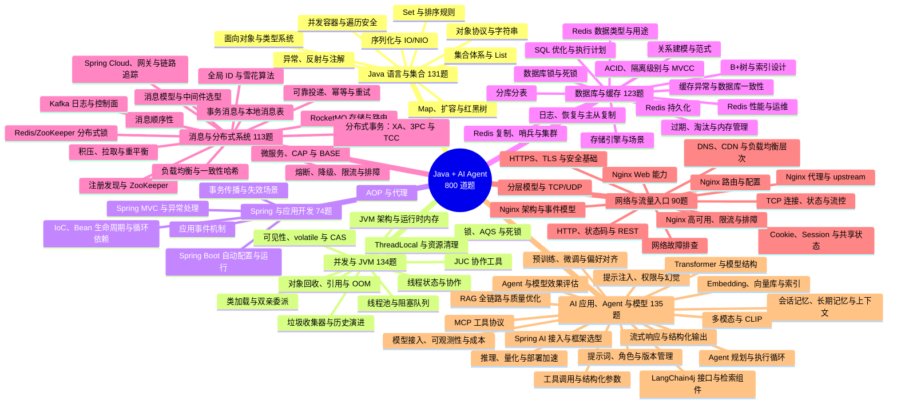

# Java + AI Agent 学习地图

基于原 PDF 的 800 道题建立。1–42 页是目录，正文从第 43 页开始；以下页码均为 PDF 物理页码。

“核心 / 进阶 / 选读”是按 Java 后端兼顾 AI 应用的学习建议，不是招聘频率统计。所有原题各保留一次，交叉主题通过相关题簇关联。

## 全景思维导图

## 建议阅读顺序

Java 语言与集合 → 线程/JMM/线程池 → JVM → Spring → MySQL → Redis → MQ/分布式 → 网络/Nginx → Java AI/RAG/Agent。

若更重视 AI 应用岗位：补齐 Java、Spring 和 SQL 基础后，可提前进入 RAG、工具调用、记忆、安全与评估；模型训练和推理原理按岗位要求深入。

## 分类概览

| 学习主线 | 题数 | 主题数 | 学习目标 |
|---|---:|---:|---|
|Java 语言与集合|131|8|从各主题的“核心”开始，再用场景题串联|
|并发与 JVM|134|10|从各主题的“核心”开始，再用场景题串联|
|Spring 与应用开发|74|6|从各主题的“核心”开始，再用场景题串联|
|数据库与缓存|123|14|从各主题的“核心”开始，再用场景题串联|
|消息与分布式系统|113|15|从各主题的“核心”开始，再用场景题串联|
|网络与流量入口|90|12|从各主题的“核心”开始，再用场景题串联|
|AI 应用、Agent 与模型|135|17|从各主题的“核心”开始，再用场景题串联|

## 相关题簇

这些是需要合并学习的相同或相近主题，不代表所有答案都能直接合并。

- **equals 与字符串比较**：Q015（p46）、Q073（p63）
- **ArrayList 与 LinkedList**：Q074（p64）、Q086（p67）
- **sleep 与 wait**：Q058（p59）、Q143（p85）
- **volatile**：Q072（p63）、Q165（p91）、Q166（p92）、Q167（p92）、Q168（p92）
- **ConcurrentHashMap 历史分段锁**：Q120（p78）、Q121（p78）、Q204（p103）
- **事务隔离与 MVCC**：Q330（p147）、Q331（p147）、Q332（p147）、Q333（p148）、Q367（p158）、Q372（p159）、Q373（p160）、Q374（p160）、Q375（p160）、Q376（p160）、Q377（p161）、Q409（p169）
- **分布式锁**：Q441（p179）、Q442（p179）、Q443（p180）、Q444（p180）、Q445（p180）、Q446（p181）、Q658（p247）、Q659（p247）、Q660（p248）
- **限流算法**：Q599（p226）、Q600（p227）、Q639（p240）、Q640（p241）、Q641（p241）、Q642（p241）
- **RAG 流程与切分**：Q698（p264）、Q699（p264）、Q763（p290）、Q765（p290）、Q800（p301）
- **向量与相似度**：Q704（p266）、Q706（p267）、Q755（p287）、Q756（p288）、Q757（p288）
- **Agent 与工具调用**：Q682（p257）、Q686（p259）、Q708（p268）、Q709（p269）、Q766（p291）、Q767（p291）、Q768（p291）、Q769（p292）、Q799（p300）
- **提示注入**：Q723（p275）、Q791（p298）

## 原文边界与核验

本次完成了分类、题号覆盖及起始页核对，没有逐条核验原答案的技术正确性。原文自带的“来源：其他 PDF 约第 × 页”只是原作者的说明，不是本次可以访问、核实的第二份材料。

内部类限制、偏向锁/CMS、Spring 自动配置、Kafka 控制器、MCP 传输和模型能力等内容有版本条件；阅读时应保留技术版本、官方出处和核验时间。没有标记的题也不等于已经验证正确。

完整可折叠导图见“学习思维导图.mm”；“分类阅读版.md”保留按主题排列的题目及原文；“题库.jsonl”可用作后续 Agent 的导入数据。
